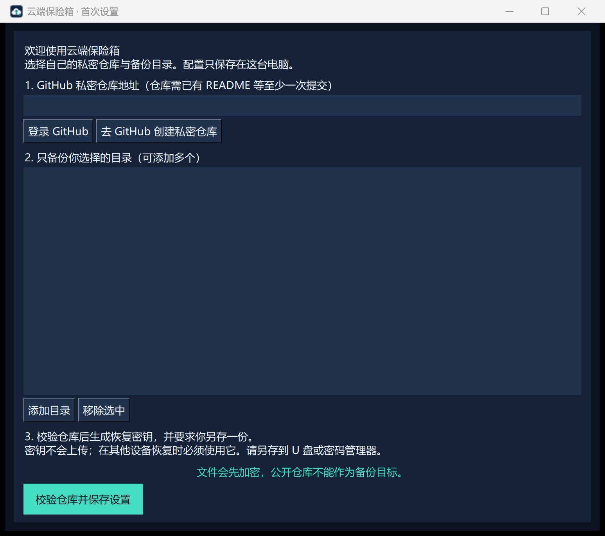
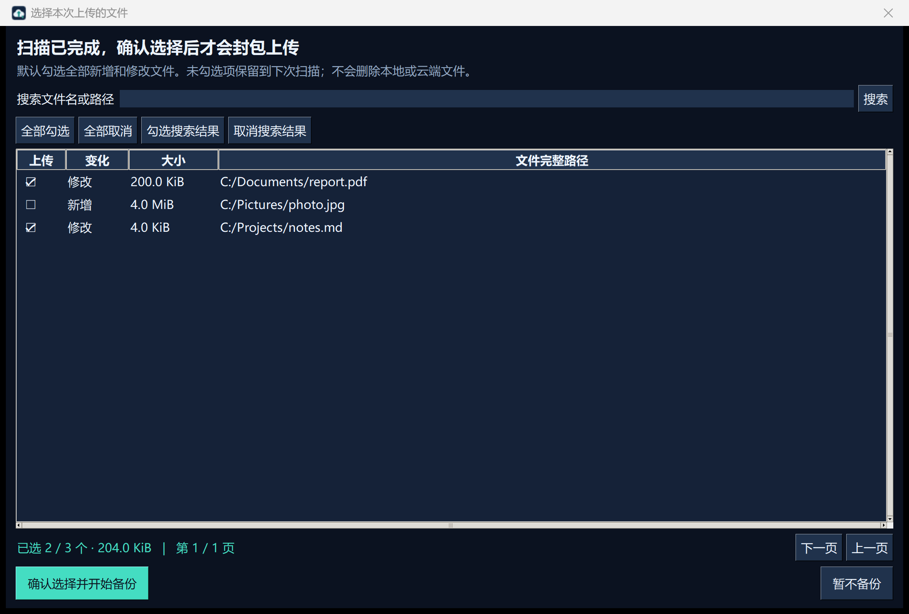

# 云端保险箱 · Cloud Vault

把自己选择的文件加密备份到 **自己的 GitHub 私密仓库**。流程为“后台扫描 → 勾选文件 → 加密上传”，支持独立后台进程、增量扫描、分包续传、每秒速度显示和恢复校验。

Encrypted incremental file backup to your own private GitHub repository. Windows desktop UI; Python backup and restore tools. MIT licensed.



## 开始使用

1. 安装 **Python 3.11 或更新版本**（包含 Tcl/Tk）和 [GitHub CLI](https://cli.github.com/)。
2. 在 GitHub 新建自己的 **私密仓库**，勾选添加 README，让仓库包含至少一次提交。开源程序的公开仓库不能作为个人备份目的地。
3. 下载本项目源码 ZIP 并解压，双击 `Install.cmd`。安装器会把程序和独立 Python 环境放到 `%LOCALAPPDATA%\CloudVault`，桌面只创建 **Cloud Vault** 快捷方式。安装依赖需要联网，不需要管理员权限。
4. 打开快捷方式，在首次设置中填写仓库地址（例如 `https://github.com/example/private-backup`）、选择备份目录。尚未登录时点击“登录 GitHub”。
5. 点击“校验仓库并保存设置”，选择一个**尚不存在**的文件名导出恢复密钥。请把这份密钥保存在独立设备或密码管理器中。完成设置后开始扫描；扫描完成会弹出文件选择界面，确认后才加密上传。

## 选择文件与后台运行



扫描完成后显示新增和修改的候选文件、完整路径及大小。默认勾选全部，可逐项取消、搜索路径、勾选或取消搜索结果，也可全部勾选或全部取消；界面实时统计勾选数量与总大小，列表分页避免大量文件卡住窗口。没有勾选的文件不封包、不上传、不推进成功索引，下次扫描仍会显示。全部取消会结束本轮而不上传。确认后还会核对内容哈希，所以仅时间戳改变的文件可能最终无需上传。

备份在独立进程中执行，**点击“—”最小化不会暂停扫描或上传**。后台每秒保存心跳和进度，重新打开窗口可连接现有任务。扫描完成后窗口会恢复并等待选择；这一步是主动等待确认。已经确认并开始封包的未完成任务会先续传，之后新扫描的候选文件再次等待选择。

Windows 后台工作期间请求阻止自动休眠，并关闭该进程的执行速度节流；请求失败会显示在日志中。等待文件选择、暂停或结束时释放请求，不改变系统电源计划，也不保持屏幕常亮。**用户主动休眠、合盖、关机或终止进程仍可能中断任务**，下次可续传。点击“×”仍表示请求保存进度并退出，需确认；仅最小化则持续运行。

后台状态保存在本地 `worker-status.json`，状态文件不含令牌或密钥。界面意外关闭不会直接终止备份，完成结果保存在报告中；窗口正常运行时（包括最小化）结束会恢复窗口并弹出通知。

需要仓库的 Contents 读写权限。程序复用 GitHub CLI 登录，不要求把访问令牌粘贴进源码或配置。不支持 GitHub Enterprise 的自定义域名。

也可直接运行源码：

```powershell
python -m pip install -r requirements.txt
python app.pyw
```

正常运行会读取用户本地数据目录的配置；源码目录没有个人配置文件。`python app.pyw --preview` 只显示演示界面。`--config PATH` 可指定独立配置；更换仓库或密钥时必须使用新的状态目录，不能复用旧索引。

## 备份如何工作

- 首次备份读取所选范围内所有未排除文件。后续先比较大小和修改时间，再计算候选文件的 SHA-256；只有内容变化才上传。“深度检查”还会发现大小、时间戳均未改变的内容变化。
- 读取时验证文件大小和修改时间是否稳定。活跃文件、拒绝访问和缺失目录会进入本次报告，不会假报完全成功。无法访问的目录不会被误记成删除。
- 使用随机 256 位恢复密钥和 AES-GCM；每个分包使用独立随机 nonce。文件名、原始路径和恢复清单也在加密包内。
- 默认约 64 MiB 原始数据一个分包，大文件会被拆分；压缩和加密会改变实际上传体积。加密后先本地解密校验，再上传。
- 先创建草稿 Release。重试会核对远端大小和 SHA-256，完整包跳过，当前未完成包重传。**这是分包续传，不是单个文件的字节偏移续传。** 关闭程序时等待当前请求结束并保存状态，网络中断可稍后重开。
- 所有附件经过一次最终远端核对、Release 成功完成后，才提交本地成功索引。重新运行会先处理未完成任务，之后再扫描新变化。
- 上传速度按本程序最近一个刷新间隔交给网络的内容字节数计算，每秒刷新，不含协议开销和其他程序流量。操作系统缓冲可能导致短暂波动。剩余上传时间参考近 15 秒均速，不含准备和最终校验时间；等待重试和等待响应会明确显示。
- 本地删除只记录，不自动删除云端历史，也不在恢复时删除目标文件。
- 仓库、恢复密钥及仓库身份与状态目录绑定。程序拒绝混用，并阻止同一配置同时执行两个备份任务。

## 恢复数据

**只恢复最后一个增量版本是不完整的。** 下载首次版本和之后需要的每个版本，按先后顺序恢复，每个 Release 的附件放在独立目录。第一份备份也是完整的版本 2 格式，不依赖其他工具。

```powershell
gh release download FIRST_TAG --repo OWNER/PRIVATE_REPO --dir restore-packages/001 --pattern "*.pcbackup"
python restore_incremental.py --key E:/cloud-vault-recovery-key.txt --archives restore-packages/001 --dest recovered

gh release download NEXT_TAG --repo OWNER/PRIVATE_REPO --dir restore-packages/002 --pattern "*.pcbackup"
python restore_incremental.py --key E:/cloud-vault-recovery-key.txt --archives restore-packages/002 --dest recovered --apply
```

将示例中的仓库、标签和路径替换成自己的值。`--apply` 明确允许用较新的备份覆盖恢复目录中的旧文件。程序验证 GCM、分包哈希、分片范围和每个完整文件的哈希后才写入目标；会检查前序版本是否已经恢复，防止跳过中间版本。恢复中断后，保留同一目录并重新执行当前命令。

Windows 文件映射到 `recovered/data/C/...`，网络共享映射到 `data/UNC/服务器/共享/...`；其他绝对路径映射到 `data/posix/...`。不会直接覆盖原系统目录。删除信息另存为 JSON。恢复目录内不要手动修改 `.cloud-vault-restore.json`，它用于记录恢复顺序。

## 本地文件与隐私

配置在 `%LOCALAPPDATA%\CloudVault\config.json`，每个仓库的状态在其 `profiles` 子目录；包含索引、运行清单、日志、加密分包和本地密钥。新用户的目录与密钥限制为当前系统账号访问。**未完成任务需要明文暂存副本**，成功后清除对应副本；这不是安全擦除，也不抵御已控制当前账号的恶意程序。

仓库公开源码中不包含任何用户配置、账号令牌、恢复密钥、备份数据或运行日志。程序不收集遥测。运行中连接 GitHub API 与上传端点；安装时从 Python 包索引下载依赖。

默认跳过已识别的凭据、`.git`、缓存、依赖环境、未下载云文件、链接及部分可重新安装的程序。排除列表是尽力识别，并不保证识别所有秘密文件；也可能排除你希望保留的文件，请检查备份范围与报告。调整所选目录可修改本地配置的 `roots`、`exclude_paths`，关闭程序后再编辑。

恢复密钥丢失后，GitHub 和本程序都无法解密。请实际测试恢复；不要把密钥和唯一备份只放在同一块磁盘。

## 边界与要求

- 当前桌面安装器和主要界面面向 Windows。核心测试同时覆盖 Windows 与 Linux；其他桌面平台未提供安装器。
- 这是文件备份，不是系统镜像，不保存 NTFS ACL、备用数据流或所有文件系统元数据。运行中的聊天或数据库文件不保证跨文件事务一致性；重要数据库应先关闭应用或使用官方导出。
- 暂存需要额外磁盘空间，上传完成的加密缓存目前不会自动清理。目录或磁盘完全损坏后仍需远端版本及独立保存的密钥恢复。
- 不保证修改备份期间始终能够探测到外部文件变化；高一致性需求应使用文件系统快照或应用级导出。
- GitHub 的权限、速率限制、容量和使用条款仍然适用。参考 [Releases API](https://docs.github.com/en/rest/releases/releases)、[Release assets API](https://docs.github.com/en/rest/releases/assets) 和 [GitHub Releases 说明](https://docs.github.com/en/repositories/releasing-projects-on-github/about-releases)。

## 开发与验证

```powershell
python -m pip install -r requirements.txt
python -m unittest discover -s tests -v
python app.pyw --preview --ui-check
```

测试使用随机临时密钥、合成文件和模拟远端，不读取个人文件，不需要真实 GitHub 令牌，不创建远端仓库。覆盖中断恢复、错误密钥、损坏数据、恢复顺序、路径越界、并发锁、目标混用、动态速度计算、文件勾选、后台心跳和启动窗口进程退出后的存活。图标使用代码绘制，随 MIT 许可提供。

安全问题请参见 [SECURITY.md](SECURITY.md)。许可证：[MIT](LICENSE)。
